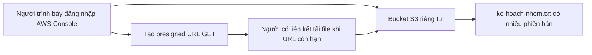

# Amazon S3: Kho tài liệu nhóm

Bộ thuyết trình tiếng Việt gồm 30 slide cho 30–40 phút và một demo chạy trực tiếp trên **AWS S3 Console**. Dự án dùng dữ liệu giả lập để giải thích S3, không cần viết web, HTML, Python hoặc Streamlit.

## Ba chức năng demo

| Chức năng | Tình huống | Kiến thức cần giải thích |
| --- | --- | --- |
| Tải lên và tải xuống | Lưu kế hoạch nhóm trong bucket riêng tư | Bucket, object, key, PUT và GET |
| Khôi phục phiên bản | Một bạn tải nhầm nội dung, nhóm lấy lại bản đúng | Versioning, version ID, cùng key nhưng khác phiên bản |
| Chia sẻ có thời hạn | Cho người khác đọc tài liệu trong vài phút | Presigned URL, quyền của người ký, thời hạn truy cập |

## Tài liệu cần mở

- [Dàn ý 30 slide và lời dẫn](docs/dan-y-30-slide.md)
- [Nội dung và yêu cầu thiết kế để đưa vào Canva](CANVA.md)
- [Hướng dẫn cấu hình và diễn demo từng bước](docs/demo-aws-console.md)
- [Câu hỏi ôn tập và trả lời khi thầy hỏi](docs/cau-hoi-on-tap.md)
- [Kết quả kiểm tra demo thực tế](docs/ket-qua-demo.md)
- [Nguồn AWS chính thức](docs/nguon-tham-khao.md)
- [Danh mục ảnh cho Canva](assets/demo/README.md)

## Thực hành nhanh

1. Tạo một bucket **General purpose** dành riêng cho bài này, dùng **S3 Standard**, bật **Versioning**, giữ **Block all public access**, ACL disabled và SSE-S3.
2. Lần đầu bật Versioning, dành ít nhất 15 phút chuẩn bị trước khi bắt đầu ghi dữ liệu theo khuyến nghị của AWS.
3. Tải `samples/v1/ke-hoach-nhom.txt` lên gốc bucket. Tải xuống để kiểm tra.
4. Tải `samples/v2/ke-hoach-nhom.txt` lên đúng cùng vị trí. Bật **Show versions** để xem hai version ID.
5. Tải xuống đúng phiên bản V1, giữ tên `ke-hoach-nhom.txt`, rồi upload lại vào gốc bucket. Đây là bản hiện tại mới chứa nội dung V1, lịch sử V2 vẫn còn.
6. Tạo presigned URL GET thời hạn ngắn từ Console. Kiểm tra truy cập trước và sau khi hết hạn.

Chi tiết nhãn nút, kết quả mong đợi và cách xử lý lỗi nằm trong [hướng dẫn demo](docs/demo-aws-console.md).

## Kiến trúc

Người nhận liên kết không cần tài khoản AWS. Liên kết chỉ dùng quyền mà người ký được phép sử dụng và có thể hết hạn sớm khi credentials hết hạn. Bucket vẫn giữ chế độ riêng tư.

## File mẫu

Hai thư mục `samples/v1/` và `samples/v2/` có file **cùng tên** để S3 tạo phiên bản cho cùng một key. Nội dung file dùng chữ không dấu để dễ quan sát kể cả khi trình duyệt hiển thị văn bản thuần. Không tải cả hai thư mục lên S3 vì sẽ tạo hai key khác nhau.

## Chi phí và dọn tài nguyên

Chỉ dùng vài file văn bản nhỏ. Chi phí phụ thuộc Region, lượng lưu trữ, số request và truyền dữ liệu. Kiểm tra Billing/Free Tier của tài khoản, không mặc định demo miễn phí.

Versioning lưu và tính dung lượng các phiên bản. Xóa object thông thường có thể chỉ tạo delete marker. Sau buổi học, làm theo phần dọn tài nguyên trong hướng dẫn để xóa **toàn bộ phiên bản và delete marker** rồi xóa bucket demo khi đã xác nhận không cần giữ. Không áp dụng việc dọn này cho bucket khác.

Không commit mật khẩu, access key, session token hoặc presigned URL thật. Ảnh trong repo phải che thông tin tài khoản và phần chữ ký URL.
