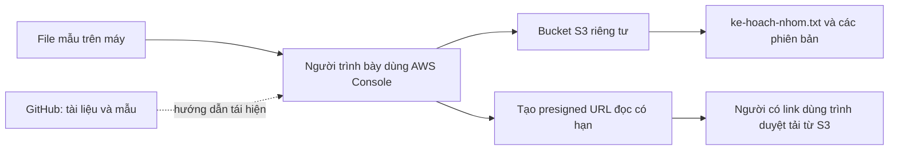

# Amazon S3: Kho tài liệu nhóm

Dự án học tập dùng **AWS S3 Console** để lưu một tệp kế hoạch, phục hồi khi sửa nhầm và chia sẻ có thời hạn. Bản trình chiếu chính là **bản gốc Canva**, kèm tài liệu hướng dẫn thực hiện ba chức năng demo.

Tải [PowerPoint bản gốc Canva](slides/Amazon-S3-ban-goc-Canva.pptx) để lưu hoặc trình chiếu. [CANVA.md](CANVA.md) tập hợp liên kết bản gốc và tài liệu demo. Bộ dàn ý 30 slide, các tệp nội dung nhập Canva cũ và ZIP cũ được giữ làm tài liệu tham khảo.

Xem trực tuyến: **[Bản gốc trên Canva](https://canva.link/67bxz0ua9w88aoh)**.

### Báo cáo và kịch bản thuyết trình

- [Báo cáo Amazon S3 định dạng Word](docs/bao-cao-amazon-s3.docx): cơ sở lý thuyết, thiết kế kho tài liệu nhóm, ba chức năng demo, kết quả thực nghiệm, ảnh minh chứng và tài liệu tham khảo AWS. Điền tên nhóm, thành viên, lớp và giảng viên ở trang bìa trước khi nộp.
- [Kịch bản thuyết trình định dạng Word](docs/kich-ban-thuyet-trinh-amazon-s3.docx): lời nói theo đúng **28 slide gốc**, thao tác và kết quả cần thấy, chuyển ý, câu hỏi ôn tập và cách xử lý sự cố. Tổng thời lượng gợi ý **35 phút 30 giây**, gồm 4 phút hỏi đáp; cần tập lại để căn thời gian thực tế.

Ảnh kiểm thử presigned URL dùng 5 phút (300 giây); kịch bản trên lớp gợi ý tạo link mới 1 phút. Hình minh họa Singapore trên slide 25 được phân biệt với bucket demo thật `cloudnotes-starlight` ở Sydney trong kịch bản.

**Không có ứng dụng web hoặc máy chủ cục bộ cần bật.** Bạn không phải cài Python, Streamlit, HTML, thư viện hay dependency của dự án. “Chạy dự án” nghĩa là đăng nhập AWS, tạo hoặc mở bucket demo và làm ba thao tác bên dưới. Clone repository chỉ tải tài liệu và tệp mẫu, không tự tạo tài nguyên trên AWS.

Repository: [st4rlight3/amazon-s3-kho-tai-lieu-demo](https://github.com/st4rlight3/amazon-s3-kho-tai-lieu-demo), hiện **public**; người xem có thể mở tài liệu không cần đăng nhập GitHub. Bucket S3 của demo vẫn riêng tư. Trạng thái kiểm chứng thực tế nằm trong [báo cáo demo](docs/ket-qua-demo.md); các kết quả mô tả dưới đây là tiêu chí cần kiểm tra, không thay cho bằng chứng đã chạy.

## 1. Sản phẩm làm được gì?

| Chức năng | Tình huống | Điều cần hiểu |
| --- | --- | --- |
| Upload và download | Lưu rồi lấy lại kế hoạch nhóm | Bucket, object, key, PUT và GET |
| Khôi phục bằng Versioning | Một bạn ghi nội dung sai lên cùng tệp | Cùng key, nhiều Version ID; phục hồi thành bản mới |
| Chia sẻ có thời hạn | Cho người khác tải tài liệu tạm thời | Presigned URL, quyền người ký và thời hạn |

Phạm vi: một **general purpose bucket riêng tư**, lớp **S3 Standard**, một key gốc `ke-hoach-nhom.txt`. Demo không dùng website hosting, ứng dụng backend hay IAM access key.



## 2. Chuẩn bị và lấy tệp dự án

- Tài khoản AWS hoạt động; ưu tiên đăng nhập bằng danh tính **IAM/role** hoặc phiên do nhà trường cấp. Không dùng root cho thao tác thường ngày và không tạo access key cho bài này.
- Danh tính cần quyền tạo/cấu hình bucket, liệt kê object/versions, ghi và đọc object. Người tạo URL cần quyền đọc tương ứng; dọn tài nguyên cần quyền xóa cả versions và bucket. Tài khoản lab có thể giới hạn các quyền này.
- Trình duyệt, cửa sổ riêng tư/ẩn danh, mạng ổn định và quyền lưu/mở tệp văn bản trên máy.
- Kiểm tra Billing/Free Tier thực tế của tài khoản trước khi tạo tài nguyên; không mặc định bài demo miễn phí.

**Cách A — có Git:** mở Terminal và chạy; không cần đăng nhập GitHub để clone repository public:

```bash
git clone https://github.com/st4rlight3/amazon-s3-kho-tai-lieu-demo.git
cd amazon-s3-kho-tai-lieu-demo
```

Nếu clone không thành công, kiểm tra đường dẫn repository và kết nối mạng. Không dán token vào lệnh, URL hoặc tệp dự án.

**Cách B — không dùng Git:** mở repository → **Code → Download ZIP** → giải nén; không cần đăng nhập GitHub. Không cần cài thư viện sau khi tải bằng một trong hai cách.

Các tệp quan trọng:

```text
samples/v1/ke-hoach-nhom.txt     Bản kế hoạch đúng: Thu Sau, 14:00
samples/v2/ke-hoach-nhom.txt     Bản sửa nhầm: Thu Hai, 08:00
docs/demo-aws-console.md        Hướng dẫn chi tiết và kịch bản demo
docs/ket-qua-demo.md            Kết quả quan sát thực tế
slides/Amazon-S3-ban-goc-Canva.pptx  Bản trình chiếu gốc xuất từ Canva
CANVA.md                       Liên kết bản gốc và tài liệu demo
```

Mở cả hai tệp mẫu để thấy nội dung khác nhau. Hai file cố ý có **cùng tên**; khi upload chỉ chọn file bên trong, không upload cả thư mục `v1` hoặc `v2`.

## 3. Bật kho tài liệu trên AWS

### Tạo hoặc mở đúng bucket

1. Đăng nhập [AWS Management Console](https://console.aws.amazon.com/) và mở dịch vụ **S3**.
2. Bucket của bài là **`cloudnotes-starlight`**, Region **Asia Pacific (Sydney), `ap-southeast-2`**. Nếu bucket này đã thuộc tài khoản của bạn và dành cho bài demo, mở nó rồi kiểm tra cấu hình bên dưới.
3. Nếu tái hiện từ đầu, chọn **General purpose buckets → Create bucket**, chọn Sydney và **General purpose**. Nếu có lựa chọn namespace, dùng **shared global namespace**.
4. Nhập `cloudnotes-starlight`. Trong shared global namespace, tên phải chưa được dùng trong cùng AWS partition; nếu bị trùng, chọn một tên riêng có ý nghĩa cho nhóm bạn. Không bắt buộc thêm ngày hoặc chuỗi số ngẫu nhiên.
5. Đặt các mục sau rồi chọn **Create bucket**. Chỉ dùng bucket dành riêng cho dữ liệu mẫu.

| Thiết lập | Chọn | Ý nghĩa |
| --- | --- | --- |
| Object Ownership | ACLs disabled / Bucket owner enforced | Chủ bucket quản lý quyền qua policy, không dùng ACL |
| Block Public Access | **Block all public access**, cả bốn mục bật | Giữ bucket/object khỏi các cách cấp quyền public |
| Bucket Versioning | **Enable** | Giữ các lần ghi cùng key thành các phiên bản |
| Default encryption | **SSE-S3**, khóa do Amazon S3 quản lý | Mã hóa dữ liệu khi lưu, không cần cấu hình KMS |
| Object Lock | Không bật | Không thêm cơ chế khóa lưu giữ vào bài demo |
| Static website hosting | Để Disabled | Bài này là kho object riêng tư |

Chọn **S3 Standard khi upload object** ở phần tiếp theo; đây là storage class của object, không phải nút khởi động bucket. Region xác định nơi lưu; SSE-S3 bảo vệ dữ liệu khi lưu, còn quyền truy cập là một cơ chế riêng.

### Kiểm tra trước khi upload

1. Trong **Properties**, kiểm tra **Bucket Versioning: Enabled** và **Default encryption: SSE-S3**.
2. Trong **Permissions**, kiểm tra **Block all public access: On** và Object Ownership là **Bucket owner enforced**.
3. Kiểm tra tên bucket và Region Sydney; không đổi quyền hoặc xóa dữ liệu của bucket khác.
4. Khi **bật Versioning lần đầu**, AWS khuyến nghị **chờ 15 phút trước các thao tác ghi/xóa**. Làm phần này trước giờ thuyết trình. [AWS: bật Versioning](https://docs.aws.amazon.com/AmazonS3/latest/userguide/manage-versioning-examples.html)

Bucket không cần lệnh “start”. Sau khi cấu hình xong, lần sau chỉ cần đăng nhập Console và mở lại nó; giữ tài nguyên cho tới khi không còn cần trình diễn.

## 4. Chức năng 1 — Upload và download V1

1. Mở bucket → **Objects → Upload → Add files**.
2. Chọn riêng `samples/v1/ke-hoach-nhom.txt`; tên đích phải là **`ke-hoach-nhom.txt` ở gốc bucket**.
3. Giữ quyền riêng tư, SSE-S3 và storage class **S3 Standard** → **Upload**.
4. Khi thành công, quay về danh sách, mở object để xem key, dung lượng và thời điểm cập nhật.
5. Chọn **Download**, mở file nhận được và tìm dòng **`Lich demo: Thu Sau, 14:00`**.

**Kết quả cần thấy:** nội dung tải về khớp V1. Bucket chứa object; key xác định object trong bucket. Console đã thực hiện yêu cầu ghi/đọc cho bạn bằng quyền của phiên đăng nhập.

## 5. Chức năng 2 — Sửa nhầm rồi phục hồi V1

1. Trở lại **Objects → Upload**, chọn `samples/v2/ke-hoach-nhom.txt` và upload **cùng gốc, cùng key**.
2. Download bản hiện tại, mở và tìm **`Thu Hai, 08:00 (SUA NHAM)`** để chứng minh nội dung đã đổi.
3. Mở object → **Versions**, hoặc bật **Show versions** trong danh sách. Xác định bản đầu theo thời gian và Version ID, không chỉ dựa vào tên.
4. Chọn **đúng version đầu tiên trên S3** → **Download / Actions → Download**. Nếu dùng Open, phải mở đúng version đã chọn rồi lưu nguyên nội dung văn bản thành file `.txt`.
5. Lưu bản vừa lấy từ S3 vào một thư mục riêng; mở kiểm tra có dòng **`Lich demo: Thu Sau, 14:00`**.
6. Nếu trình duyệt thêm hậu tố như `ke-hoach-nhom (1).txt`, đổi tên về chính xác **`ke-hoach-nhom.txt`**. Bật hiển thị phần mở rộng để tránh tên `ke-hoach-nhom.txt.txt`.
7. Upload **file vừa lấy từ version cũ** về gốc bucket, đúng cùng key. Không dùng V1 có sẵn trong `samples` để thay cho việc lấy lại dữ liệu từ S3.
8. Download bản hiện tại lần nữa: lịch phải trở lại **14:00**. Xem Versions để thấy bản hiện tại mới cùng các bản trước.

**Kết quả cần thấy:** trong một lần chạy sạch có ba versions. Bản thứ ba có nội dung V1, V2 vẫn còn trong lịch sử. V1/V2/V3 là tên gọi trong bài; Version ID thật do S3 tạo. Nếu luyện nhiều lần, số versions có thể lớn hơn ba.

Đây là **khôi phục bằng một lần ghi mới**, không cần xóa phiên bản nào. Mỗi version là một bản đầy đủ, tiếp tục chiếm dung lượng và được tính phí. [AWS: khôi phục phiên bản](https://docs.aws.amazon.com/AmazonS3/latest/userguide/RestoringPreviousVersions.html)

## 6. Chức năng 3 — Chia sẻ đọc có thời hạn

### So sánh URL thường với URL đã ký

1. Mở thông tin object và sao chép **Object URL thông thường**.
2. Dán vào cửa sổ ẩn danh không đăng nhập AWS: với cấu hình private của bài, GET dự kiến bị từ chối **403 AccessDenied**. Không dùng nút Open của Console cho phép thử này vì nó có thể tạo yêu cầu đã xác thực.
3. Quay lại danh sách object, chọn file → **Object actions/Actions → Share with a presigned URL**.
4. Chọn **5 phút**, như thời hạn dùng cho lần kiểm chứng của dự án → **Create presigned URL** → sao chép liên kết vào ghi chú riêng tạm thời.
5. Mở link vừa ký trong cửa sổ ẩn danh: nội dung phải hiển thị hoặc tải xuống, không cần tài khoản AWS cho người nhận.
6. Ghi lại giờ tạo. Sau hơn 5 phút, dán URL vào **tab/cửa sổ riêng tư mới để gửi GET mới**: dự kiến bị từ chối.

**Kết quả cần thấy:** URL thường bị chặn → URL có chữ ký còn hạn tải được → yêu cầu mới sau hạn bị chặn. Block Public Access vẫn bật suốt quá trình. Một file đã tải hoặc trang trong cache không tự biến mất khi link hết hạn.

Khi đã tập quen, có thể chọn **1 phút cho phần live demo** để giảm thời gian chờ. Chọn đúng hạn mới ở bước tạo URL và chờ đủ hạn đó trước khi thử lại; không sửa con số trong URL. Căn thời gian ba chức năng khi tập toàn bài.

### Hiểu giới hạn của liên kết

- Đây là link **có thể dùng nhiều lần khi còn hiệu lực**, không phải link một lần. Ai có link có thể dùng quyền đã ký.
- Console cho chọn từ **1 phút đến 12 giờ**; link có thể hết sớm nếu credentials tạm thời của người ký hết hạn hoặc bị thu hồi. [AWS: thời hạn URL](https://docs.aws.amazon.com/AmazonS3/latest/userguide/using-presigned-url.html)
- Hết hạn chặn yêu cầu mới, không thu hồi bản người nhận đã tải; một lượt tải bắt đầu trước hạn có thể tiếp tục.
- Không đăng URL thật lên GitHub, Canva, mã QR, ghi chú thuyết trình hay ảnh chụp. Che toàn bộ liên kết và thông tin tài khoản trong bằng chứng.

## 7. Chi phí và tắt tài nguyên sau buổi học

Tệp nhỏ và ít thao tác giúp hạn chế chi phí nhưng không bảo đảm hóa đơn bằng 0. Kiểm tra **Billing**, credits/Free Tier và giá ở Region đã chọn. S3 tính phí theo dung lượng/thời gian lưu, requests, dữ liệu truyền và các tính năng sử dụng; versions cũ cũng tính dung lượng. [AWS S3 Pricing](https://aws.amazon.com/s3/pricing/)

**Muốn giữ để trình diễn lại:** đóng tab trình duyệt là được, nhưng dữ liệu vẫn lưu và có thể tính phí. Không có cơ chế tự xóa trong dự án.

**Muốn dọn hoàn toàn sau khi chấm:**

1. Lưu bằng chứng cần giữ; xác nhận chính xác bucket demo của mình, không chọn bucket khác.
2. Trong danh sách bucket, chọn đúng bucket → **Empty**, đọc phạm vi và xác nhận. Hành động này xóa vĩnh viễn cả versions và delete markers; không thể phục hồi bằng Versioning sau đó.
3. Chờ thành công, kiểm tra Show versions không còn dữ liệu/marker; hủy incomplete multipart uploads nếu có.
4. Trở về danh sách → **Delete**, nhập đúng tên bucket theo yêu cầu rồi xác nhận.
5. Kiểm tra Billing sau đó; số liệu có thể cập nhật trễ, chi phí đã phát sinh trước khi dọn vẫn được tính.

Chỉ Delete object thông thường trong bucket bật Versioning có thể thêm **delete marker** và giữ các version cũ, nên chưa phải dọn sạch. [AWS: empty bucket](https://docs.aws.amazon.com/AmazonS3/latest/userguide/empty-bucket.html)

## 8. Xử lý nhanh khi không chạy được

| Hiện tượng | Kiểm tra |
| --- | --- |
| Clone/ZIP không truy cập repo | Kiểm tra đúng đường dẫn repository public và kết nối mạng; không cần đăng nhập GitHub |
| Tên bucket không dùng được | Chọn tên riêng có ý nghĩa, đúng quy tắc; không cần thêm ngày hay số tùy tiện |
| Console báo AccessDenied | Kiểm tra IAM/role với người quản lý tài khoản; không tắt Block Public Access để sửa lỗi |
| Không thấy nhiều versions | Versioning đã Enabled trước upload chưa? Có cùng key, cùng vị trí không? Bật Show versions |
| Phục hồi tạo file khác | Sửa tên có `(1)`, sai chữ hoa/thường, dư `.txt` hoặc nhầm prefix rồi upload đúng key |
| 404 sau bật Versioning lần đầu | Chờ đủ khoảng 15 phút theo khuyến nghị của AWS rồi thử lại |
| Link đã ký lỗi ngay | Kiểm tra đủ URL, phiên người ký còn hạn và quyền đọc; tạo lại từ Console |
| Hết hạn mà vẫn đọc được | Đang nhìn bản đã tải/cache; gửi yêu cầu mới trong cửa sổ riêng tư mới |

## 9. Làm slide và chuẩn bị trình bày

1. Dùng [PowerPoint bản gốc Canva](slides/Amazon-S3-ban-goc-Canva.pptx) làm bản trình chiếu chính, hoặc mở [bản gốc trực tuyến](https://canva.link/67bxz0ua9w88aoh).
2. Tài liệu AWS và demo trong repository dùng để chuẩn bị phần thực hành; bản PowerPoint giữ nội dung và thiết kế của bản gốc Canva.
3. Chuẩn bị bucket/Versioning từ trước, mở sẵn Console, file mẫu và cửa sổ ẩn danh. Làm lần lượt upload/download, ghi đè rồi phục hồi và chia sẻ có thời hạn theo [hướng dẫn demo](docs/demo-aws-console.md).
4. Các ảnh thật nằm trong [assets/demo](assets/demo/README.md), kết quả kiểm chứng nằm trong [báo cáo demo](docs/ket-qua-demo.md). Số slide trong danh mục ảnh áp dụng cho bộ dàn ý 30 slide tham khảo, không xác định vị trí trong bản Canva gốc.
5. Ảnh thử hết hạn dùng **5 phút (300 giây)**; phần live có thể chọn **1 phút**. Khi giải thích ảnh, phân biệt hai thời hạn này; thử bằng request mới sau hạn và không đưa URL thật lên slide.
6. Tập toàn bài và trả lời [10 câu hỏi ôn tập](docs/cau-hoi-on-tap.md). Mỗi thành viên nên hiểu cả ba chức năng và tự căn thời gian theo buổi thuyết trình.

### Tài liệu tham khảo của bản 30 slide

[Dàn ý 30 slide](docs/dan-y-30-slide.md), [canva-noi-dung.txt](canva-noi-dung.txt), [DAN-VAO-CANVA.txt](DAN-VAO-CANVA.txt) và [bo-canva-s3.zip](bo-canva-s3.zip) là bộ chuẩn bị trước đó, chỉ dùng để tham khảo. Các số trang và thời lượng trong bộ này không áp dụng cho bản Canva gốc. Ba sơ đồ SVG về [kiến trúc](assets/so-do-kien-truc.svg), [Versioning](assets/so-do-versioning.svg) và [link tạm thời](assets/so-do-link-tam-thoi.svg) là hình giải thích khái niệm, không phải bằng chứng kiểm thử.

Tra cứu thêm trong [hướng dẫn demo chi tiết](docs/demo-aws-console.md) và [nguồn AWS chính thức](docs/nguon-tham-khao.md). Không đưa mật khẩu, mã MFA, access key, session token hoặc presigned URL thật vào repository.
